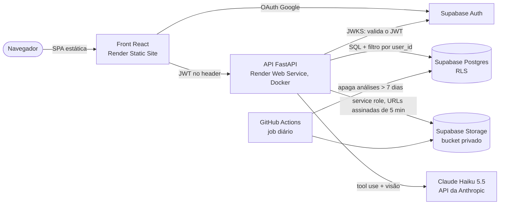

# Global Watch — assistente geoespacial para café

Aplicação web em que o usuário entra com Google, envia uma imagem Sentinel-2 e conversa com uma
IA sobre **áreas potenciais** de cultivo de café. O resultado é potencial, sem validação em
campo: o kit não tem gabarito, e a app não mostra acurácia nem confiança.

- **Aplicação:** <https://globalwatch-cafe.onrender.com> (entre com qualquer conta Google; nada a
  pagar nem chave a fornecer)
- **API:** <https://globalwatch-cafe-api.onrender.com/health>
- **Vídeo (3 min):** <!-- link na T7.6 -->
- **Nota de pesquisa:** [`docs/nota-de-pesquisa.md`](docs/nota-de-pesquisa.md)
  ([PDF](docs/nota-de-pesquisa.pdf)) · método em detalhe: [`docs/metodo.md`](docs/metodo.md)
- **Uso de IA:** [`docs/uso-de-ia.md`](docs/uso-de-ia.md)

> A API do plano gratuito do Render hiberna após 15 minutos sem tráfego. O primeiro acesso
> depois disso leva cerca de um minuto; a interface mostra um aviso enquanto ela acorda.

## O que a aplicação faz

1. Login com Google (Supabase Auth); o backend valida o JWT em toda rota exceto `/health`.
2. Envio de um GeoTIFF de 4 bandas (azul, verde, vermelho, NIR em DN uint16), com a camada SCL
   opcional e, também opcional, uma segunda data do mesmo recorte.
3. Processamento em segundo plano: reflectância, NDVI e GNDVI, máscara de qualidade, cascata de
   exclusões, polígonos e área em hectares.
4. Mapa com a imagem, os polígonos, a legenda, a data e a área; clique no polígono mostra a área
   e o NDVI dele. Downloads: imagem com polígonos (PNG) e GeoJSON.
5. Chat com Claude, que apresenta a análise com a imagem classificada e responde sobre
   resultados e limitações. Números e geometrias chegam ao modelo só por ferramentas que leem o
   resultado salvo, e cada resposta mostra um card com o que a ferramenta devolveu.

## Arquitetura



- **Frontend** (`frontend/`): Vite, React 19, TypeScript, Tailwind, shadcn/ui, MapLibre GL
  (basemap OpenFreeMap) e TanStack Query. Telas: login, lista de análises, análise (mapa,
  resumo, downloads e chat).
- **Backend** (`backend/`): FastAPI. O `POST /analyses` valida o arquivo, grava a linha como
  `pending` e responde 202; um worker na mesma instância processa uma análise por vez
  (rasterio, numpy, scipy, shapely, pyproj), envia PNGs e GeoJSON ao Storage e grava o
  resultado. O front consulta o status até `completed` ou `failed`. Análise parada há mais de
  15 minutos (reinício do Render) vira `failed` com mensagem legível.
- **Banco** (`supabase/migrations/`): `analyses`, `chat_messages` e `usage_daily`, com RLS por
  `auth.uid()`; o backend também filtra por `user_id` em todo SQL.
- **Chat** (`backend/app/chat/`): laço manual de tool use com três ferramentas
  (`get_analysis_summary`, `get_polygon`, `get_limitations`), prompt de sistema fixo e no máximo
  cinco rodadas por mensagem.

## Método (resumo)

Cascata de exclusões com limiares explícitos, versionada como `spectral-rules-1.1`:

| Nível | Regra | Kit (16/08/2025) |
| --- | --- | --- |
| N0–N1 | NoData e máscara de qualidade (SCL; sem SCL, NDWI ≥ 0) | 0,00 ha |
| N2 | NDVI < 0,55: solo e pasto seco | 1.279,76 ha |
| N3 | NDVI > 0,72: dossel fechado | 870,46 ha |
| N3c | Amplitude de NDVI ≥ 0,25 entre duas datas (opcional) | — |
| N4 | Morfologia e manchas < 0,5 ha | 256,68 ha |
| | **Área potencial** (124 polígonos) | **214,54 ha** |

A soma dá os 2.621,44 ha do kit. A conversão de DN para reflectância é feita uma vez, na
leitura; a área é contada em UTM antes de reprojetar para o mapa. Os parâmetros e a versão do
método são gravados com cada análise. Fontes, alternativas e justificativa estão na
[nota de pesquisa](docs/nota-de-pesquisa.md).

**Imagem adicional:** `scripts/download_additional_scene.py` baixa a cena de 10/01/2026
(estação chuvosa, mesma grade do kit, com SCL e atribuição) para `data/adicional/`, onde ela já
está versionada. Ela pode ser
enviada sozinha ou como segunda data do kit.

## Execução local

Pré-requisitos: Docker com Compose, um projeto Supabase (gratuito) e, para o chat, uma chave da
API da Anthropic.

1. **Supabase:**
   - aplique as migrations em ordem (`psql "$DATABASE_URL" --single-transaction -f
     supabase/migrations/001_init.sql`, depois `002` e `003`); a `002` cria o bucket privado
     `analyses`;
   - em Authentication → Providers, ative Google com o Client ID e o Secret de um cliente OAuth
     do Google Cloud, e cadastre `http://localhost:5173` em Redirect URLs.
2. **Variáveis:** copie `backend/.env.example` para `backend/.env` e
   `frontend/.env.example` para `frontend/.env.local`, e preencha. Os comentários dizem de onde
   vem cada valor.
3. **Subir:** `docker compose up --build`. API em <http://localhost:8000> (documentação em
   `/docs`, só com `API_DOCS=true`) e front em <http://localhost:5173>, com recarga automática.
4. **Testar com o kit:** envie `data/exemplo/imagem_multiespectral.tif` com
   `data/exemplo/qualidade_scl.tif` como SCL.

Sem Docker: `backend/` com `python3 -m venv .venv && .venv/bin/pip install -e ".[dev]"` e
`.venv/bin/uvicorn app.main:app --reload`; `frontend/` com `npm ci && npm run dev`.

## Testes e evidências

| O quê | Como rodar | O que cobre |
| --- | --- | --- |
| Backend | `cd backend && .venv/bin/pytest -q` | 325 testes; os de banco precisam de `TEST_DATABASE_URL` (o CI usa Postgres 17) |
| RLS | `docker compose --profile test run --rm rls-test` | Migrations + `supabase/tests/rls_isolation.sql` num Postgres descartável |
| Front | `cd frontend && npm run lint && npm run build` | oxlint, tipos e build |
| CI | `.github/workflows/ci.yml` | Os três acima a cada push |

**Processamento** (`backend/tests/`):

- `test_reader.py`: DN → reflectância uma vez só, bandas pela descrição, NoData.
- `test_indices.py`, `test_masking.py`, `test_classification.py`: índices, máscara e cada
  nível da cascata.
- `test_area.py`, `test_vectorization.py`: kit = 2.621,44 ha, área em UTM, polígonos.
- `test_pipeline.py`, `test_temporal.py`: kit de ponta a ponta (214,54 ha, 124 polígonos) e
  regra de duas datas.

**Segurança:**

- `test_auth.py`: 401 em todas as rotas sem token, com token expirado, com assinatura errada e
  anônimo; `/docs` fechado em produção.
- `test_isolation.py`: matriz de todas as rotas com `{analysis_id}` tirada do OpenAPI; análise de
  outro usuário dá 404 e nada muda para o dono.
- `test_upload.py`: 413 (tamanho), 415 (não é TIFF pela assinatura) e 422 (sem CRS, bandas,
  tipo, dimensão); recusa não cria análise nem gasta cota.
- `test_ratelimit.py`, `test_usage.py`, `test_errors.py`, `test_retention.py`: limites
  diários, 500 neutro sem vazar detalhe e retenção de 7 dias.
- `test_repository.py`: filtro por `user_id` no SQL e incremento atômico da cota, contra
  Postgres.

**Evidências** (`docs/evidencias/`): telas em 375 e 1440 px; conversas reais do chat
(`chat.md`); execuções em produção com tempos e números (`producao.md`); auditoria de segredos
no histórico, no bundle e no Render (`segredos.md`); calibração, comparação entre datas e
inspeção visual (`calibracao/`, `comparacao-datas/`, `inspecao/`).

## Segurança

- **Autenticação:** JWT do Supabase validado no backend pela JWKS (assinatura, emissor,
  audiência e expiração) em toda rota exceto `/health`; login anônimo recusado.
- **Isolamento:** RLS no Postgres e filtro por `user_id` em todo SQL; recurso de outro usuário
  responde 404, nunca 403. Arquivos em `<user_id>/<analysis_id>/` num bucket privado, lidos só
  por URL assinada de 5 minutos.
- **Upload:** até 20 MB, extensão `.tif/.tiff` e assinatura TIFF conferidas, CRS, 4 bandas,
  uint16 e no máximo 2048 x 2048 px. Arquivo recusado não é gravado.
- **Erros:** exceção inesperada vira 500 com mensagem neutra em português; o detalhe fica só no
  log.
- **Segredos:** só em variáveis de ambiente (Render e `.env` ignorado pelo git). O front recebe
  apenas a URL do Supabase, a chave pública (anon) e a URL da API. CORS restrito à origem do
  front; `/docs` e `/openapi.json` desligados em produção.
- **Custo do LLM:** limite diário por usuário e teto de gasto na conta da Anthropic.

## Serviços, cotas e suspensão

Planos gratuitos conferidos nas páginas oficiais em **30/10/2026**:

| Serviço | Uso | Cota do plano gratuito | Inatividade |
| --- | --- | --- | --- |
| Render, Static Site | Front | Banda e minutos de build do workspace (ver painel de cobrança) | Não hiberna |
| Render, Web Service | API | 750 h de instância por mês; uma instância; disco efêmero | Hiberna após 15 min sem tráfego; acorda em ~1 min |
| Supabase Free | Auth, Postgres, Storage | 500 MB de banco, 1 GB de arquivos, 5 GB de egress, 50 mil usuários ativos por mês, upload de até 50 MB, 2 projetos ativos | Pausa o projeto após 1 semana sem atividade |
| Anthropic API | Chat (Claude Haiku 5.5) | Paga por uso, com teto de gasto na conta; o avaliador não precisa de chave | — |
| GitHub Actions | CI e retenção | Gratuito em repositório público | Agendamentos desligam após 60 dias sem atividade no repositório |
| OpenFreeMap | Basemap | Gratuito, sem chave nem limite de visualizações | — |

**Contra a pausa do Supabase:** o job diário de retenção consulta o banco todo dia, o que basta
para o projeto não ficar uma semana inativo. Se o repositório passar 60 dias sem commits, o
GitHub desliga o agendamento; basta reativar em Actions. Se o projeto for pausado, ele é
restaurado pelo painel do Supabase.

## Limites de uso e retenção

- **Por usuário e por dia (UTC):** 20 envios de imagem e 50 mensagens no chat, contados no
  Postgres. Acima disso a API responde 429 com mensagem em português. A tela de envio e o chat
  mostram quanto resta e a hora da renovação; com a cota no fim, os controles ficam
  desabilitados.
- **Retenção:** cada análise (linha, arquivos e conversa) é apagada 7 dias depois de criada,
  pelo workflow `.github/workflows/retention.yml` (todo dia às 06:00 UTC). A interface mostra o
  prazo em cada análise. O usuário também pode apagar a qualquer momento.
- O arquivo enviado fica no Storage junto com os PNGs e o GeoJSON, e sai com a análise.

## Limitações

- O resultado é **área potencial**, não café: sem gabarito de campo, não há acurácia.
- Uma ou duas datas não separam café de outras perenes, pasto irrigado ou capoeira com vigor
  parecido; bordas de mata entram na faixa de NDVI.
- Sem SWIR, café e eucalipto se separam só pelo teto de NDVI, que também corta café adensado;
  café jovem ou podado fica abaixo do piso.
- Limiares calibrados no kit, da seca no sul de Minas; uma imagem da estação chuvosa gera área
  potencial dominada por pasto.
- Uma análise por vez na instância gratuita (cerca de 20 s para o kit); a fila fica em memória e
  se perde num reinício, quando a análise vira `failed` com aviso.
- Imagens até 2048 x 2048 px e 20 MB.

## Estrutura

```text
specs/          SDD: constituição, modelos e uma pasta por funcionalidade (001 a 007)
backend/        FastAPI: app/ (rotas, processamento, chat, worker) e tests/
frontend/       React: src/pages, src/components, src/lib
supabase/       migrations e teste de RLS
scripts/        cena adicional, calibração, comparação entre datas, inspeção, exportação da nota
data/exemplo/   kit original (não alterado; SHA256SUMS.txt confere)
docs/           nota de pesquisa, método, uso de IA e evidências
```

## Como o projeto foi desenvolvido

Desenvolvimento orientado a especificação: cada funcionalidade tem requisitos (EARS), design e
tarefas em [`specs/`](specs/), com aprovação humana entre as fases e uma task por vez, seguindo a
[constituição](specs/000-constituicao.md). Toda mudança aponta para uma task `T<n>.<m>`, e cada
task feita com IA está registrada em [`docs/uso-de-ia.md`](docs/uso-de-ia.md), com o que foi
validado e os erros pegos.

## Licença e atribuição

- Código sob a licença [MIT](LICENSE).
- Contains modified Copernicus Sentinel data (2025, 2026). Veja
  [`data/exemplo/ATRIBUICAO.txt`](data/exemplo/ATRIBUICAO.txt).
- Mapa base: OpenFreeMap, © OpenMapTiles, dados © OpenStreetMap contributors.
- Figuras de conferência derivadas do Projeto MapBiomas (Coleção 10, 2024), sob CC BY-SA 4.0.
