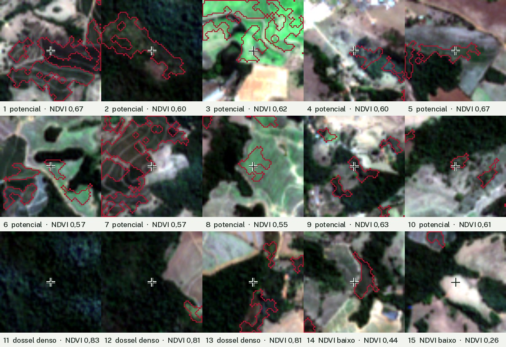

# Inspeção visual de 15 pontos do kit (T7.1, R7.7)

Gerada por `scripts/inspect_points.py`, que roda as funções do pipeline do backend sobre o kit
(parâmetros padrão, `method_version` atual) e sorteia os pontos com semente fixa (7). Cada
recorte tem 600 x 600 m de cor verdadeira em torno do ponto (cruz no centro), com a área
potencial contornada em cereja. Prancha: [`prancha.jpg`](prancha.jpg). Coordenadas e NDVI:
[`pontos.csv`](pontos.csv).

São 15 pontos sem gabarito de campo. A leitura serve para ver se o resultado faz sentido e
onde ele erra. Não estima acurácia, e por isso não vira percentual.

Primeira leitura feita pela IA (Claude, com visão) sobre os recortes ampliados; revisão
humana registrada no fim.

## Leitura dos pontos

| Ponto | Grupo | NDVI | O que se vê | Leitura |
| --- | --- | --- | --- | --- |
| 1 | potencial | 0,67 | Talhões em faixas, separados por carreadores em curva de nível | Compatível com café |
| 2 | potencial | 0,60 | Clareira de tom médio dentro da mata, com manchas de solo | Provável capoeira ou regeneração |
| 3 | potencial | 0,62 | Verde intenso e uniforme, bem mais claro que o resto da cena em agosto | Provável lavoura ou pasto irrigado |
| 4 | potencial | 0,60 | Árvores de tom médio junto a estrada e construções | Indefinido (quintal, pomar ou borda de mata) |
| 5 | potencial | 0,67 | Faixa estreita entre a mata e um talhão claro | Indefinido (borda de mata) |
| 6 | potencial | 0,57 | Manchas verde-claras entre fragmentos de mata e uma estrada, sem fileiras visíveis | Indefinido (pasto verde ou lavoura) |
| 7 | potencial | 0,57 | Talhões em faixas com carreadores em curva de nível | Compatível com café |
| 8 | potencial | 0,55 | Talhão verde-claro com textura de linhas | Lavoura em fileiras (café jovem ou outra cultura) |
| 9 | potencial | 0,63 | Manchas junto a casas e à borda da mata | Indefinido (quintal, pomar ou borda de mata) |
| 10 | potencial | 0,61 | Pequena mancha de árvores na borda da mata, em meio a pasto seco | Provável borda de mata |
| 11 | dossel denso | 0,83 | Mata densa | Exclusão coerente |
| 12 | dossel denso | 0,81 | Mata densa ao lado de solo preparado | Exclusão coerente |
| 13 | dossel denso | 0,81 | Mata, perto de um polígono potencial | Exclusão coerente |
| 14 | NDVI baixo | 0,44 | Talhão de tom médio que continua um polígono potencial vizinho | Possível talhão com menos vigor deixado de fora |
| 15 | NDVI baixo | 0,26 | Solo exposto ou pasto seco | Exclusão coerente |

## O que a inspeção mostra

- **Na área potencial (10 pontos):**
  - 3 têm aparência de lavoura em fileiras (1, 7 e 8); 1 e 7 têm o padrão de talhões em curva
    de nível típico do café da região.
  - 4 são indefinidos (4, 5, 6 e 9).
  - 3 provavelmente não são café (2, 3 e 10).
- **Erro que se repete: bordas de mata.** A borda mistura copa e solo ou pasto num pixel de
  10 m, e o NDVI do pixel cai dentro da faixa de 0,55 a 0,72 (pontos 5, 9 e 10). A faixa de
  NDVI sozinha não tira esses pixels; a limpeza por morfologia tira só parte deles.
- **Verde atípico na seca.** O ponto 3 é verde demais para agosto e sugere irrigação. Uma
  única data não separa isso de café; a segunda data (spec 003) mede a variação, mas não
  separa irrigação.
- **Nas exclusões (5 pontos):** 4 são coerentes (mata e solo). O ponto 14 parece um talhão
  com menos vigor; café podado, jovem ou com falhas fica abaixo do piso de 0,55 e é omitido.

## Revisão humana

Em 30/10/2026 o usuário revisou a prancha e aceitou a leitura acima sem correções.
